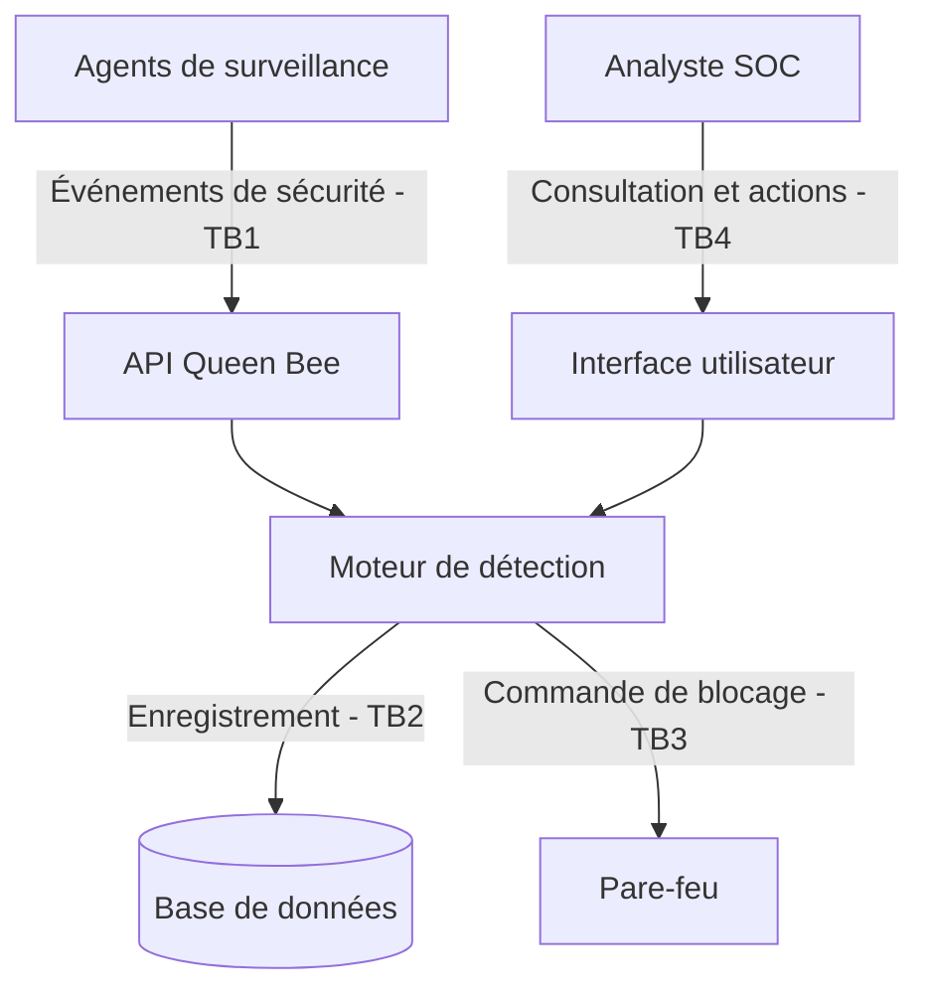

# Modèle de menaces — Queen Bee

## 1. Actifs

| Actif | Pourquoi il compte | C / I / D / P |
|---|---|---|
| Incidents | Permettent de suivre les attaques et les actions de réponse | C, I, P |
| Clé HMAC agents | Empêche un attaquant de se faire passer pour un agent légitime | C, I |
| Règles de détection | Permettent de reconnaître les attaques informatiques | I, D |
| Journaux de sécurité | Conservent les événements et les preuves d'attaque | I, P |
| Base de données | Stocke les incidents et leur historique | C, I, D |
| Service de détection | Analyse les événements et génère les alertes | D, I |

## 2. Acteurs

| Acteur | Rôle |
|---|---|
| Agent (machine) | Envoie les journaux de sécurité à Queen Bee |
| Analyste SOC | Consulte les alertes et traite les incidents |
| Administrateur | Configure et maintient Queen Bee |
| Attaquant externe | Cherche à accéder au système ou à perturber son fonctionnement |
| Agent compromis | Machine normalement autorisée, mais contrôlée par un attaquant |

## 3. Frontières de confiance

| Frontière | Communication | Pourquoi la contrôler ? |
|---|---|---|
| TB1 | Agents → API Queen Bee | Vérifier l'identité des agents et empêcher les faux événements |
| TB2 | Application → Base de données | Empêcher les accès et modifications non autorisés |
| TB3 | Application → Pare-feu | Empêcher les commandes de blocage non autorisées |
| TB4 | Analyste → Interface utilisateur | Vérifier les droits des utilisateurs avant toute action |

### Diagramme de flux de données (DFD)

## 4. STRIDE par flux

| Flux | S | T | R | I | D | E | Exigence |
|---|---|---|---|---|---|---|---|
| Agent → API ingestion | Faux agent | Message modifié | Agent nie un envoi | Fuite des journaux | Envoi massif de messages | Accès non autorisé | EX-01, EX-02, EX-03 |
| API → Moteur de détection | Faux événement | Données falsifiées | Absence de traçabilité | Exposition des événements | Saturation du traitement | Contournement des validations | EX-04 |
| Application → Base de données | Faux accès applicatif | Modification des incidents | Suppression des traces | Lecture des incidents | Saturation de la base | Accès administrateur abusif | EX-05, EX-06 |
| Application → Pare-feu | Fausse commande | Modification d'une règle | Action non tracée | Fuite de configuration | Blocage abusif du réseau | Modification non autorisée | EX-07 |
| Analyste → Interface utilisateur | Usurpation de compte | Modification d'un incident | Action non journalisée | Consultation non autorisée | Saturation des requêtes | Obtention de droits admin | EX-08 |

## 5. Exigences de sécurité (EX-nn, testables)

- EX-01 : Chaque message envoyé par un agent doit être authentifié avec HMAC-SHA256 et une comparaison en temps constant. Menace : usurpation d'identité. DICP : I. Test : `test_abuse_forged_signature_rejected`.

- EX-02 : Les messages dépassant la taille maximale autorisée doivent être rejetés. Menace : saturation du service. DICP : D. Test : `test_oversized_message_rejected`.

- EX-03 : L'API doit limiter le nombre de requêtes envoyées par un agent. Menace : déni de service. DICP : D. Test : `test_rate_limit_enforced`.

- EX-04 : Le moteur de détection doit refuser les événements malformés et vérifier les données reçues. Menace : falsification des données. DICP : I. Test : `test_invalid_event_rejected`.

- EX-05 : Seuls les composants autorisés doivent pouvoir consulter ou modifier les incidents enregistrés. Menace : accès non autorisé. DICP : C, I. Test : `test_database_access_denied`.

- EX-06 : Chaque modification d'incident doit être enregistrée avec son auteur et sa date. Menace : répudiation. DICP : P. Test : `test_incident_audit_trail`.

- EX-07 : Une commande de blocage envoyée au pare-feu doit être validée et autorisée avant son exécution. Menace : élévation de privilèges. DICP : I, D. Test : `test_unauthorized_firewall_action_rejected`.

- EX-08 : Seuls les analystes authentifiés et disposant des droits nécessaires doivent pouvoir effectuer des actions sur les incidents. Menace : usurpation et élévation de privilèges. DICP : C, I. Test : `test_analyst_permissions_enforced`.

