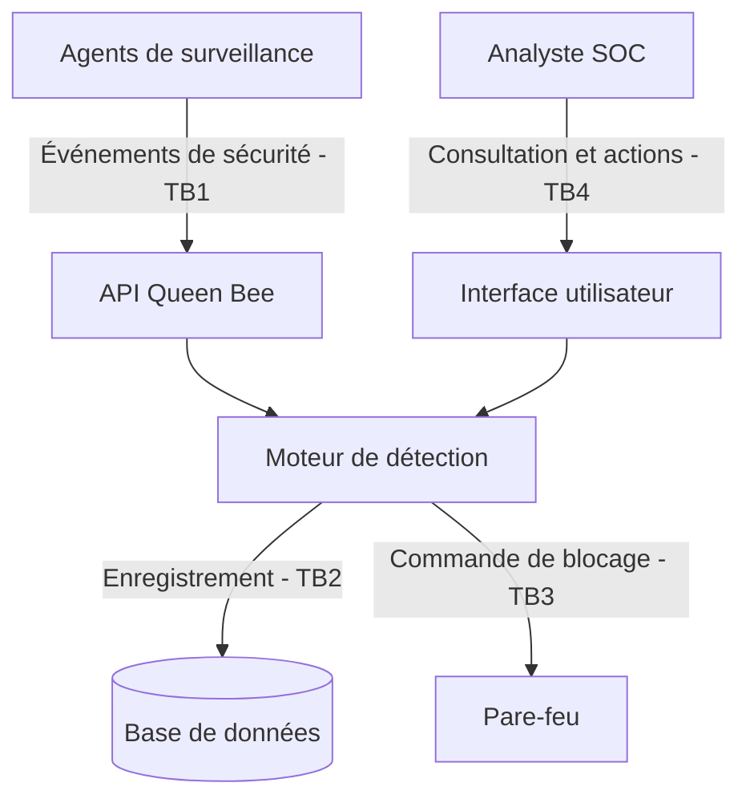

# Modèle de menaces — Queen Bee

## 1. Actifs

| Actif | Pourquoi il compte | C / I / D / P |
|---|---|---|
| Incidents | Permettent de suivre les attaques et les actions de réponse | C, I, P |
| Clé HMAC agents | Empêche un attaquant de se faire passer pour un agent légitime | C, I |
| Règles de détection | Permettent de reconnaître les attaques informatiques | I, D |
| Journaux de sécurité | Conservent les événements et les preuves d'attaque | I, P |
| Base de données | Stocke les incidents et leur historique | C, I, D |
| Service de détection | Analyse les événements et génère les alertes | D, I |

**Légende :** C = Confidentialité, I = Intégrité, D = Disponibilité, P = Preuve / traçabilité.

## 2. Acteurs

| Acteur | Rôle |
|---|---|
| Agent (machine) | Envoie les journaux de sécurité à Queen Bee |
| Analyste SOC | Consulte les alertes et traite les incidents |
| Administrateur | Configure et maintient Queen Bee |
| Attaquant externe | Cherche à accéder au système ou à perturber son fonctionnement |
| Agent compromis | Machine normalement autorisée, mais contrôlée par un attaquant |

## 3. Frontières de confiance

| Frontière | Communication | Pourquoi la contrôler ? |
|---|---|---|
| TB1 | Agents → API Queen Bee | Vérifier l'identité des agents et empêcher les faux événements |
| TB2 | Application → Base de données | Empêcher les accès et modifications non autorisés |
| TB3 | Application → Pare-feu | Empêcher les commandes de blocage non autorisées |
| TB4 | Analyste → Interface utilisateur | Vérifier les droits des utilisateurs avant toute action |

### Diagramme de flux de données (DFD)

Ce diagramme représente les flux prévus pour Queen Bee. L'API authentifiée et l'intégration à un pare-feu réel restent à finaliser.

## 4. STRIDE par flux

| Flux | S | T | R | I | D | E | Exigence |
|---|---|---|---|---|---|---|---|
| Agent → API ingestion | Faux agent | Message modifié | Agent nie un envoi | Fuite des journaux | Envoi massif de messages | Accès non autorisé | EX-01, EX-02, EX-03 |
| API → Moteur de détection | Faux événement | Données falsifiées | Absence de traçabilité | Exposition des événements | Saturation du traitement | Contournement des validations | EX-04 |
| Application → Base de données | Faux accès applicatif | Modification des incidents | Suppression des traces | Lecture des incidents | Saturation de la base | Accès administrateur abusif | EX-05, EX-06 |
| Application → Pare-feu | Fausse commande | Modification d'une règle | Action non tracée | Fuite de configuration | Blocage abusif du réseau | Modification non autorisée | EX-07 |
| Analyste → Interface utilisateur | Usurpation de compte | Modification d'un incident | Action non journalisée | Consultation non autorisée | Saturation des requêtes | Obtention de droits admin | EX-08 |

### Signification de STRIDE

- **S — Spoofing :** usurpation d'identité.
- **T — Tampering :** modification non autorisée des données.
- **R — Repudiation :** possibilité de nier une action faute de preuve.
- **I — Information Disclosure :** divulgation d'informations confidentielles.
- **D — Denial of Service :** déni de service.
- **E — Elevation of Privilege :** obtention de privilèges non autorisés.

## 5. Exigences de sécurité (EX-nn, testables)

### EX-01 — Authentification des agents

Chaque message envoyé par un agent doit être authentifié avec HMAC-SHA256 et une comparaison en temps constant.

- Menace : usurpation d'identité.
- DICP : I.
- Test prévu : `test_abuse_forged_signature_rejected`.
- État : à finaliser pendant l'A3.

### EX-02 — Limitation de la taille des messages

Les messages dépassant la taille maximale autorisée doivent être rejetés.

- Menace : saturation du service.
- DICP : D.
- Test prévu : `test_oversized_message_rejected`.
- État : validation des lignes SSH déjà testée ; limite des messages de l'API à finaliser pendant l'A3.

### EX-03 — Limitation des requêtes

L'API doit limiter le nombre de requêtes envoyées par un agent.

- Menace : déni de service.
- DICP : D.
- Test prévu : `test_rate_limit_enforced`.
- État : limitation des notifications déjà testée ; limitation des requêtes API restant à implémenter.

### EX-04 — Validation des événements

Le moteur de détection doit refuser les événements malformés et vérifier les données reçues.

- Menace : falsification des données.
- DICP : I.
- Test prévu : `test_invalid_event_rejected`.
- État : validation des journaux SSH déjà testée ; validation stricte de l'API à finaliser.

### EX-05 — Protection des incidents

Seuls les composants autorisés doivent pouvoir consulter ou modifier les incidents enregistrés.

- Menace : accès non autorisé.
- DICP : C, I.
- Test prévu : `test_database_access_denied`.
- État : contrôle de lecture avec Proxy testé ; autorisations de modification à finaliser.

### EX-06 — Traçabilité des modifications

Chaque modification d'incident doit être enregistrée avec son auteur et sa date.

- Menace : répudiation.
- DICP : P.
- Test prévu : `test_incident_audit_trail`.
- État : journal d'audit complet à vérifier et à finaliser.

### EX-07 — Sécurisation des commandes pare-feu

Une commande de blocage envoyée au pare-feu doit être validée et autorisée avant son exécution.

- Menace : élévation de privilèges et injection de commandes.
- DICP : I, D.
- Test prévu : `test_unauthorized_firewall_action_rejected`.
- État : validation des adresses IP et annulation des commandes testées ; autorisation et intégration réelle à finaliser.

### EX-08 — Autorisation des analystes

Seuls les analystes authentifiés et disposant des droits nécessaires doivent pouvoir effectuer des actions sur les incidents.

- Menace : usurpation et élévation de privilèges.
- DICP : C, I.
- Test prévu : `test_analyst_permissions_enforced`.
- État : contrôle des rôles pour la lecture testé ; contrôle des modifications à finaliser.

## 6. Patterns défensifs du Jour 2

Cinq patterns ont été développés pour renforcer la sécurité de Queen Bee.

| Pattern | Protection | Menace STRIDE | Vérification |
|---|---|---|---|
| Proxy | Refuse la consultation des incidents sans rôle autorisé | Information Disclosure, Elevation of Privilege | 3 tests réussis |
| Decorator | Limite le nombre de notifications transmises | Denial of Service | 3 tests réussis |
| Adapter | Transforme les journaux SSH en événements validés | Tampering, Denial of Service | 7 tests réussis |
| Observer | Transmet les alertes à plusieurs abonnés, même si l'un échoue | Denial of Service, Disponibilité | 3 tests réussis |
| Command | Valide les adresses IP et permet d'annuler un blocage | Tampering, Elevation of Privilege | 4 tests réussis |

### Proxy — Contrôle des accès

Le composant `IncidentReaderProxy` protège la consultation des incidents.

Il autorise les rôles `viewer` et `analyst` et refuse les autres rôles.

Les tests vérifient également qu'une consultation refusée n'appelle pas le dépôt d'incidents.

### Decorator — Limitation des alertes

Le composant `RateLimitedNotifier` limite le nombre de notifications transmises pendant une période donnée.

Un test simule 1 000 alertes avec une limite de 3 notifications :

- 3 alertes transmises.
- 997 alertes ignorées par le limiteur.

Cette protection concerne actuellement les notifications. Elle ne remplace pas une limitation des requêtes à l'entrée de l'API.

### Adapter — Validation des journaux SSH

L'adaptateur de journaux SSH transforme une ligne valide en objet `SecurityEvent`.

Il rejette notamment :

- Les lignes trop longues.
- Les caractères nuls.
- Les formats inattendus.
- Les tentatives d'injection dans les données.

### Observer — Résistance aux défaillances

Le composant `ObserverNotifier` transmet une alerte à plusieurs abonnés.

Si un abonné échoue, les autres peuvent continuer à recevoir l'alerte.

Les échecs sont comptabilisés pour faciliter leur suivi.

### Command — Sécurisation du blocage IP

Le composant `BlockIpCommand` valide l'adresse IP avant son utilisation.

Une entrée malveillante telle que `1.2.3.4; iptables -F` est rejetée.

Le pare-feu utilisé dans les tests est simulé par `InMemoryFirewall`. Aucune règle réseau réelle n'est modifiée.

Le composant `CommandHistory` permet également d'annuler une commande de blocage.

## 7. Mesures complémentaires prévues pour l'A3

L'atelier A3 doit compléter les protections aux frontières de confiance.

| Mesure | Frontière | Menace principale |
|---|---|---|
| Authentification HMAC-SHA256 | TB1 | Spoofing |
| Limite de 4 096 octets pour les messages agents | TB1 | Denial of Service |
| Validation stricte du JSON et rejet des champs inattendus | TB1 | Tampering |
| Vérification des droits avant modification d'un incident | TB4 | Elevation of Privilege |
| Contrôle des transitions d'état | TB2, TB4 | Tampering |
| Vérification des dépendances entre couches | Architecture interne | Contournement des contrôles métier |

La vérification des dépendances doit notamment garantir que le domaine ne dépend pas des adaptateurs techniques.

## 8. Vérification et preuves

### Résultats obtenus

- 20 tests réussis pour les cinq patterns défensifs.
- 36 tests réussis pour l'ensemble des parties déjà développées.
- Ruff : aucune erreur détectée.
- Mypy : aucune erreur détectée sur 18 fichiers.

### Vérifications restantes

- Tests des messages HMAC falsifiés.
- Tests des messages JSON malformés ou trop volumineux.
- Tests des modifications d'incidents sans autorisation.
- Test par propriétés avec Hypothesis.
- Vérification des dépendances avec `lint-imports`.
- Exécution de `make check` sur l'ensemble du projet.

## 9. Risques résiduels

Même avec ces protections, plusieurs risques restent à prendre en compte :

- Un agent légitime compromis peut transmettre de fausses informations avec une signature valide.
- Une clé HMAC divulguée peut permettre l'usurpation d'un agent.
- Un système de notification saturé peut perdre des alertes si aucun mécanisme de conservation n'est prévu.
- Un utilisateur disposant d'un rôle autorisé peut effectuer une action abusive si les permissions sont trop larges.
- Un pare-feu réel nécessite des contrôles supplémentaires avant toute modification de ses règles.

Ces risques devront être pris en compte lors de l'évolution de Queen Bee.

## 10. Conclusion

Le modèle de menaces permet d'identifier les actifs sensibles, les acteurs, les frontières de confiance et les principales attaques possibles contre Queen Bee.

Les cinq patterns défensifs du Jour 2 apportent des protections concrètes, vérifiées par des tests.

L'atelier A3 doit compléter ces mesures en sécurisant les messages des agents, les autorisations applicatives et les dépendances entre les couches de l'architecture hexagonale.
